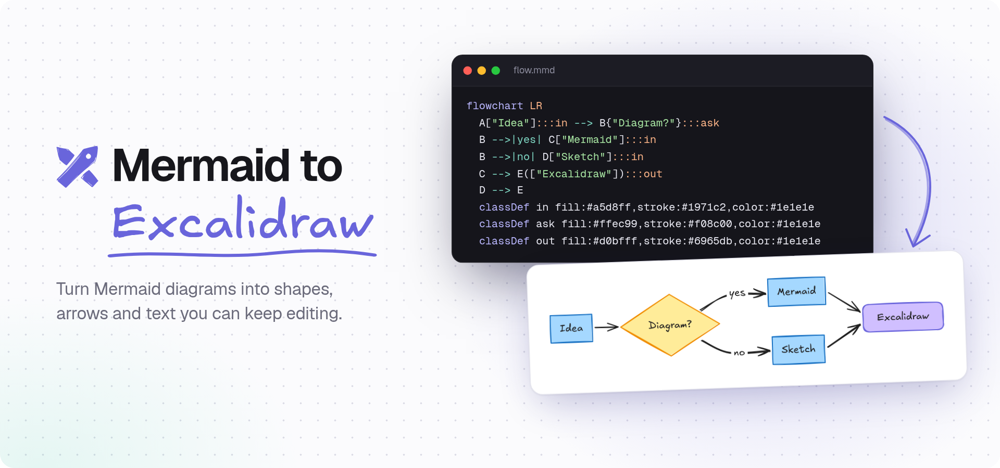

<p align="center">
  <picture>
    <source media="(prefers-color-scheme: dark)" srcset=".github/assets/banner-dark.png">
    
  </picture>
</p>

<p align="center">
  <a href="https://plus.excalidraw.com/docs/mermaid-to-excalidraw"><b>Documentation</b></a> ·
  <a href="https://mermaid-to-excalidraw.vercel.app">Playground</a> ·
  <a href="https://www.npmjs.com/package/@excalidraw/mermaid-to-excalidraw">npm</a> ·
  <a href="https://plus.excalidraw.com">Excalidraw+</a> ·
  <a href="https://excalidraw.com">Excalidraw</a>
</p>

<p align="center">
  <a href="https://www.npmjs.com/package/@excalidraw/mermaid-to-excalidraw"></a>
  <a href="LICENSE"></a>
</p>

Convert [Mermaid](https://mermaid.js.org) diagram definitions into Excalidraw elements: shapes, arrows and text you can keep editing, not a picture of the diagram. It's what [excalidraw.com](https://excalidraw.com) runs when you paste a Mermaid definition onto the canvas.

## Features

- ✏️ **Editable result**: nodes become shapes, edges become arrows bound to them, labels stay where the layout put them.
- 📊 **Many diagram types**: flowcharts (including `swimlane-beta`), sequence, class, ER and state diagrams, Gantt charts, quadrant charts and timelines. Other types are inserted as an image.
- 🎨 **Styles carry over**: `style`, `classDef` and `class` colors, `click` links, and edges as elbow arrows on request.
- ⚡ **No Mermaid runtime**: [Pele](https://pele.run) parses and lays diagrams out without rendering them into the page, and each diagram type's code loads on first use.

## Install

```bash
npm install @excalidraw/mermaid-to-excalidraw @excalidraw/excalidraw
```

It needs DOM APIs (`DOMParser`), so run it in a browser or with [jsdom](https://github.com/jsdom/jsdom).

## Quick start

```ts
import { parseMermaidToExcalidraw } from "@excalidraw/mermaid-to-excalidraw";
import { convertToExcalidrawElements } from "@excalidraw/excalidraw";

const definition = `flowchart LR
  A[Write the definition] --> B{Valid?}
  B -->|yes| C[Excalidraw elements]
  B -->|no| D[Parse error]`;

try {
  const { elements, files } = await parseMermaidToExcalidraw(definition, {
    elbow: true, // optional: draw edges as elbow arrows
  });

  excalidrawAPI.updateScene({
    elements: convertToExcalidrawElements(elements),
  });
  if (files) {
    excalidrawAPI.addFiles(Object.values(files));
  }
} catch (error) {
  // Not valid Mermaid syntax: show the error to the user
}
```

No code needed? The [Excalidraw CLI](https://github.com/excalidraw/cli) runs it from your terminal: `npx @excalidraw/cli mermaid flow.mmd --out flow.excalidraw`.

## Documentation

📚 **[plus.excalidraw.com/docs/mermaid-to-excalidraw](https://plus.excalidraw.com/docs/mermaid-to-excalidraw)**

- [Getting started](https://plus.excalidraw.com/docs/mermaid-to-excalidraw/getting-started)
- [API and config options](https://plus.excalidraw.com/docs/mermaid-to-excalidraw/api)
- [Supported diagrams](https://plus.excalidraw.com/docs/mermaid-to-excalidraw/supported-diagrams)
- [Upgrading from v2](https://plus.excalidraw.com/docs/mermaid-to-excalidraw/upgrading-from-v2) (v2 is maintained on the [`release/2.x`](https://github.com/excalidraw/mermaid-to-excalidraw/tree/release/2.x) branch)
- [How it works](https://plus.excalidraw.com/docs/mermaid-to-excalidraw/how-it-works) and [adding a diagram type](https://plus.excalidraw.com/docs/mermaid-to-excalidraw/adding-a-diagram-type)

What changed in each release is in the [changelog](CHANGELOG.md).

## Contributing

See [CONTRIBUTING.md](CONTRIBUTING.md) for running the playground and the tests.

## License

[MIT](LICENSE)
