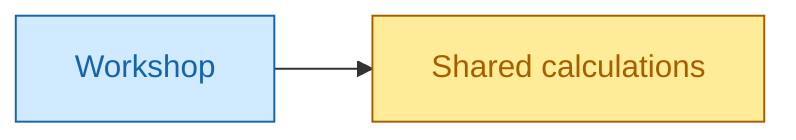

# mermaid-to-excalidraw

Convert mermaid diagrams to excalidraw

## Set up

Install packages:

```
yarn
```

Start development playground:

```
yarn start
```

Build command:

```
yarn build
```

## Command line

The CLI converts a Mermaid file into an `.excalidraw` file you can open and edit.
It runs a local headless Chromium browser and closes it when the export finishes.
Node.js 18 or newer is required.

From this project folder, set it up once:

```sh
yarn install
npx playwright install chromium
yarn build
npm link --ignore-scripts
```

You can then run the command from any folder:

```sh
mermaid-to-excalidraw diagram.mmd -o diagram.excalidraw
```

Without `-o`, the output uses the input filename with an `.excalidraw` extension,
saved in your current folder. You can also run it without a global link:

```sh
node /absolute/path/to/mermaid-to-excalidraw/cli/index.mjs diagram.mmd
# Or, from the project folder:
yarn cli diagram.mmd
```

The input can be raw Mermaid or a Markdown file containing one fenced `mermaid`
block. Multiple Mermaid blocks are rejected so each output contains one diagram.

```sh
# Include an editable resource list beside the diagram and export an SVG preview:
mermaid-to-excalidraw diagram.mmd --resources resources.md --svg diagram.svg

# Read from a pipe:
cat diagram.mmd | mermaid-to-excalidraw - -o diagram.excalidraw

# Set the diagram font size:
mermaid-to-excalidraw diagram.mmd --font-size 24

# Pass a Mermaid configuration JSON file:
mermaid-to-excalidraw diagram.mmd --config mermaid-config.json

# Replace an existing output:
mermaid-to-excalidraw diagram.mmd --force

mermaid-to-excalidraw --help
```

`--resources` accepts text or Markdown. It adds an editable text block, preserving
the resource IDs and file paths. Mermaid code fences are removed from that block,
so a Markdown file containing both the diagram and its resource list can be used
as both input and `--resources`. This option renders text rather than a rich
Markdown table.

For flowchart node colors, use Mermaid's `classDef`, `class`, and `style` directives:



Flowcharts, sequence diagrams, class diagrams, ER diagrams, and state diagrams
have converters for editable shapes. Other diagram types and some unsupported
features can fall back to an SVG image; the CLI reports when that happens.
Some Mermaid styles, including custom edge colors, are not currently converted.

After changing the converter or CLI browser code, run `yarn build` again.
`yarn test:cli` checks exports from another working folder, colors, resource
lists, piped input, errors, and overwrite behavior.

## Library API

```ts
parseMermaidToExcalidraw(diagramDefinition: string, config?: MermaidConfig)
```

The `diagramDefinition` is the mermaid diagram definition.
and `config` is the mermaid config. You can use the `config` param when you want to pass some custom config to mermaid.

Currently `mermaid-to-excalidraw` only supports the :point_down: config params

```ts
{
  /**
   * Whether to start the diagram automatically when the page loads.
   * @default false
   */
  startOnLoad?: boolean;
  /**
   * The flowchart curve style.
   * @default "linear"
   */
  flowchart?: {
    curve?: "linear" | "basis";
  };
  /**
   * Theme variables
   * @default { fontSize: "20px" }
   */
  themeVariables?: {
    fontSize?: string;
  };
  /**
   * Maximum number of edges to be rendered.
   * @default 500
   */
  maxEdges?: number;
  /**
   * Maximum number of characters to be rendered.
   * @default 50000
   */
  maxTextSize?: number;
}
```

Example code:

```ts
import { parseMermaidToExcalidraw } from "@excalidraw/mermaid-to-excalidraw";

try {
  const { elements, files } = await parseMermaidToExcalidraw(
    diagramDefinition,
    {
      themeVariables: {
        fontSize: "25px",
      },
    }
  );
  // Render elements and files on Excalidraw
} catch (e) {
  // Parse error, displaying error message to users
}
```

## Playground

Try out [here](https://mermaid-to-excalidraw.vercel.app).

## Development

- `yarn test:visual` to run visual tests
- `yarn test:visual:update` to update visual tests
- `yarn test:visual:dev` to run visual test dev server (usually better to use this over the playground)

## API

Head over to the [docs](https://docs.excalidraw.com/docs/@excalidraw/mermaid-to-excalidraw/api).

## Support new Diagram type

Head over to the [docs](https://docs.excalidraw.com/docs/@excalidraw/mermaid-to-excalidraw/codebase/new-diagram-type).
